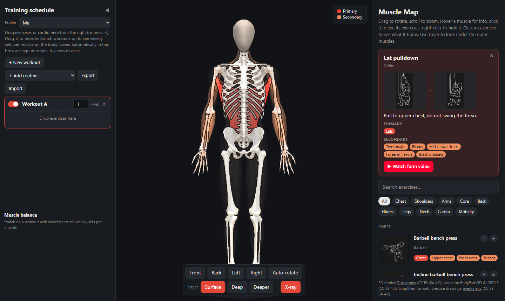

# Muscle Map

Interactive 3D anatomy model linked to gym exercises. Plan your workouts and see which muscles you train, and how much, right on the body.

**Live app: https://kalpokasaugustinas.github.io/muscle-map/** (works on phone and desktop, no install)



Built as a single static page: Three.js for the 3D view, plain JavaScript, no build step. Optional Google sign-in (Firebase) syncs your schedule across devices.

## Features

- Drag to rotate, scroll to zoom, or use the Front / Back / Left / Right / Auto-rotate buttons
- Hover over a muscle to see its name, what it does and the best exercises for it
- Click a muscle to list every exercise that trains it (primary first, then secondary)
- Click an exercise to highlight its primary muscles (red) and secondary muscles (orange)
- The ▶ button opens a YouTube search for short form videos of that exercise
- Each exercise in the list shows a drawing of the position. Hover the exercise to alternate between the start and end frames; selecting it shows both side by side. Exercises without a drawing show a small front + back body with the trained muscles highlighted instead.
- Outlines mark where one muscle ends and the next begins: strong lines between muscle groups, faint lines between parts of the same muscle
- To see hidden muscles:
  - **X-ray** (on by default): when something is selected, only the primary muscles stay solid and the rest become see-through
  - **Layer: Deep / Deeper** makes the outer muscle layers see-through. The app works out the layers itself by rendering the body from 24 directions.
  - **Right-click** a muscle to hide it. Bring it back with "Show hidden".
- The face muscles and skull are replaced by a smooth mannequin head
- **Training schedule** (left pane):
  - Create workouts and add exercises by dragging them from the right panel or pressing +
  - Set sets per exercise and how many times per week you do each workout
  - Switch workouts on to colour the body by weekly sets per muscle. Primary muscles count each set fully, secondary muscles count half. Grey = 0, blue = under 8 (under-trained), green = 8–20 (good), red = over 20 (overtraining risk). The thresholds are in `VOLUME` in `index.html`.
  - Drag the ⠿ handle to reorder exercises or move them to another workout
  - Cardio (running, cycling, hiking) is logged in minutes and converted to set-equivalents: 10 min = `rate` sets for primary muscles (1.0 running, 0.8 cycling, 0.6 hiking) and half that for secondary muscles. It's a rough estimate. Rates are in `data.js`.
  - A "Muscle balance" list ranks every muscle by weekly sets. The striped part of a bar is the share from cardio.
  - Mobility exercises (stretches) are logged in minutes. They don't count as training sets and are listed separately as stretch minutes per week.
  - "+ Add routine…" inserts a ready-made workout, e.g. "Lower back mobility (daily)", "Lower back strength" or "Daily mobility". Routines are defined in `window.ROUTINES` in `data.js`.
  - ⚠ marks exercises that need care with a sensitive lower back. Hover the sign for the reason and a back-friendly alternative. The notes are in `window.BACK_CAUTION` in `data.js`.
  - Muscles stretched by mobility work get diagonal stripes on the body: yellow = under 5 min/week, cyan = 5–15, violet = over 15
  - Hovering an exercise (in a workout or the exercise list) previews its muscles on the body
  - Hovering or clicking a muscle (on the body or in the balance list) highlights the exercises that train it, in your workouts and in the exercise list (red = primary, orange = secondary)
  - Profiles (picker at the top of the schedule): each person gets their own schedule. You can add, rename or delete profiles. Exported files include the profile name, and importing a file from another profile offers to create or update that profile.
  - The schedule and interface settings are saved automatically in this browser (localStorage). Use Export / Import to back up the schedule as a JSON file or move it to another browser.
  - **Sync across devices** (optional): "Sign in to sync" signs in with Google and keeps your profiles and schedules in your account, so they show up on your phone and computer. Changes appear live on other open devices. Without signing in, nothing leaves your browser.
- Search and filter exercises by body part

## Run

Open `index.html` in a browser. No build step is needed. Three.js is loaded from a CDN, so you need an internet connection.

Direct links: `index.html#back` opens the back view, and `index.html#ex=Deadlift` opens with an exercise selected.

Sign-in only works when the page is served over http(s) (e.g. GitHub Pages, or `python -m http.server` for `localhost`), not from `file://`.

## Cloud sync setup (Firebase)

The sync button only appears when `FIREBASE_CONFIG` in `index.html` is set. To use your own Firebase project (free Spark plan):

1. Create a project at https://console.firebase.google.com (Google Analytics not needed).
2. **Build → Authentication → Get started → Sign-in method → Google → Enable**.
3. **Authentication → Settings → Authorized domains**: add your site's domain, e.g. `<username>.github.io`.
4. **Build → Firestore Database → Create database** (production mode, any EU/US location). Under **Rules**, paste and publish:
   ```
   rules_version = '2';
   service cloud.firestore {
     match /databases/{database}/documents {
       // each signed-in user can only read and write their own document
       match /users/{uid} {
         allow read, write: if request.auth != null && request.auth.uid == uid;
       }
     }
   }
   ```
5. **Project settings → Your apps → Web (</>)**: register an app and copy the `firebaseConfig` object into `FIREBASE_CONFIG` in `index.html`.

The config values are public identifiers, not secrets. Access is controlled by the rules above. Each user's data is one document `users/<uid>` holding their profiles and schedules as JSON.

## Files

- `index.html`: UI, 3D scene, interaction (Three.js) and the optional cloud sync (Firebase)
- `data.js`: gym muscle groups and exercises. Each muscle group lists regex patterns that match anatomical mesh names in the model.
- `img/poses/`: exercise position drawings (`<id>-relaxation.svg` = start, `<id>-tension.svg` = end). They're mapped to exercises in `window.POSES` in `data.js`. Numeric ids are everkinetic drawings; `c-*` files are drawn by `tools/draw_poses.py`.
- `tools/draw_poses.py`: generates simple line-art drawings (side or front view, start and end frame) for exercises without an everkinetic drawing. To add one, add a pose pair to `EXERCISES` in the script, run it, and map the exercise in `window.POSES`.
- `model.js`: the 3D model, a Draco-compressed GLB stored as base64 so it loads from `file://`. It is generated, so don't edit it.
- `tools/export_muscles.py`: Blender script that extracts muscles, tendons and bones from Z-Anatomy and exports a simplified GLB
- `tools/build_model.py`: wraps the GLB into `model.js`

## Rebuilding the model

1. Download `Z-Anatomy.zip` from https://github.com/Z-Anatomy/Models-of-human-anatomy and unzip it.
2. Export the model: `blender -b Z-Anatomy/Startup.blend --python tools/export_muscles.py -- body.glb` (takes about 4 minutes)
3. Build `model.js`: `python tools/build_model.py body.glb`

## Credits and license

- The 3D model is from [Z-Anatomy](https://www.z-anatomy.com), licensed [CC BY-SA 4.0](https://creativecommons.org/licenses/by-sa/4.0/). It is based on BodyParts3D, © The Database Center for Life Science, licensed CC BY 4.0. This project simplifies the model for the web, and `model.js` is shared under the same CC BY-SA 4.0 license.
- The exercise drawings in `img/poses/` are from [everkinetic/data](https://github.com/everkinetic/data), licensed CC BY-SA 4.0. Some exercises use the closest available variant, e.g. a seated ab crunch drawing for the cable crunch.
